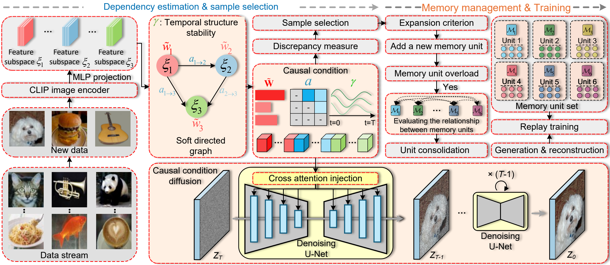

# CDGM

## Causal Dynamic Graph Memory for Continual Generative Modeling

**Tao Wu · Huaping Zhou · Adrian G. Bors**

Anhui University of Science and Technology · University of York

**Code release: Coming soon.** This repository hosts the project overview and will be updated with the implementation, training configurations, and evaluation instructions.

## Overview

CDGM studies continual image generation from a non-stationary stream without class labels or task boundaries. It connects the organization of a bounded replay memory with the conditioning of a diffusion model through learned semantic dependencies.



*Semantic graph estimation guides memory organization; current and stored structure encodings condition diffusion training.*

The framework has three main components:

- **Dynamic semantic graph:** a pre-trained image encoder and learned subspace projections provide features for a directed soft dependency graph.
- **Structure-conditioned diffusion:** current and historical graph encodings enter the denoising network through cross-attention.
- **Bounded graph memory:** graph-weighted similarity guides sample selection, while diversity-based unit consolidation and utility-based pruning manage the replay budget.

The graph provides a causal-inspired structural prior over observed features. Experiments in the manuscript cover class-incremental, cross-domain, few-shot, high-resolution, and sequential environmental streams.

## Release status

| Resource | Status |
| --- | --- |
| Project overview and framework figure | Available |
| CDGM implementation | Coming soon |
| Environment and dependency versions | Coming soon |
| Dataset preparation and stream configurations | Coming soon |
| Training and evaluation scripts | Coming soon |
| Pre-trained models | Coming soon |

Installation and usage instructions will accompany the code release. The implementation is being prepared from our [FCSDM codebase](https://github.com/Ashores/FCSDM).

## Citation

Publication details will be updated when available. To reference this project in the meantime:

```bibtex
@misc{wu2026cdgm,
  title  = {Causal Dynamic Graph Memory for Continual Generative Modeling},
  author = {Wu, Tao and Zhou, Huaping and Bors, Adrian G.},
  year   = {2026},
  url    = {https://github.com/Ashores/CDGM},
  note   = {Project repository; code release in preparation}
}
```

## Contact

Tao Wu: [taow@aust.edu.cn](mailto:taow@aust.edu.cn)
